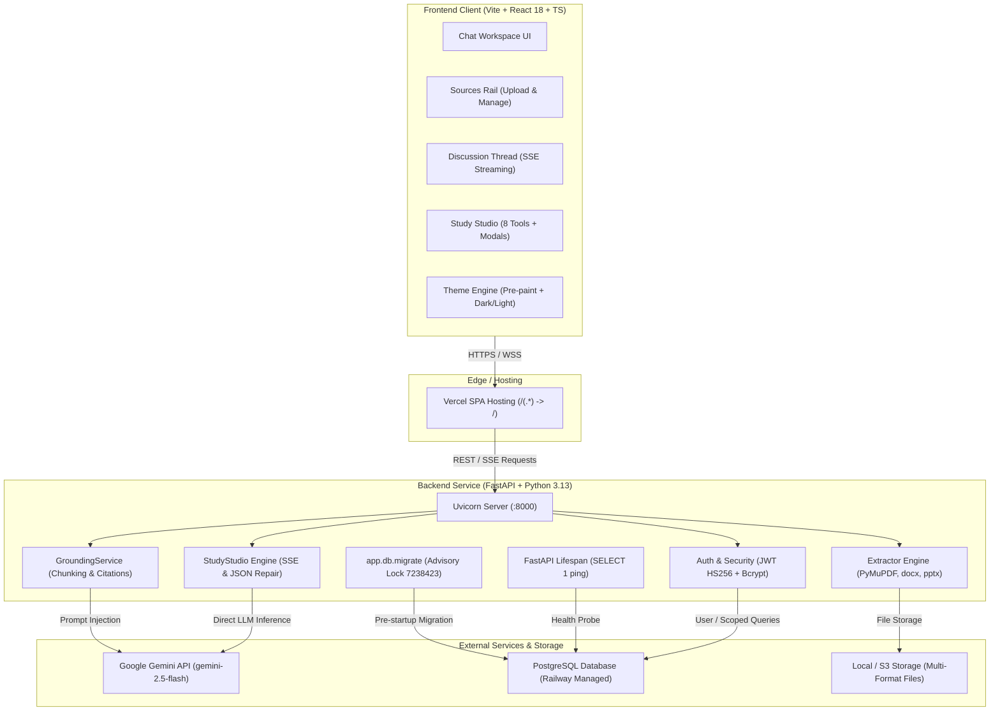
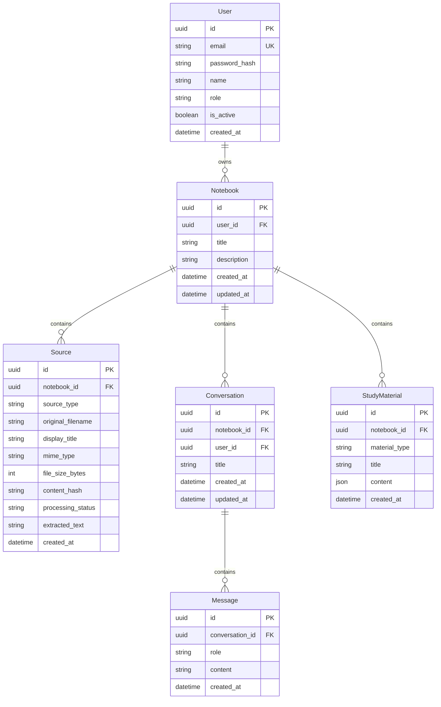
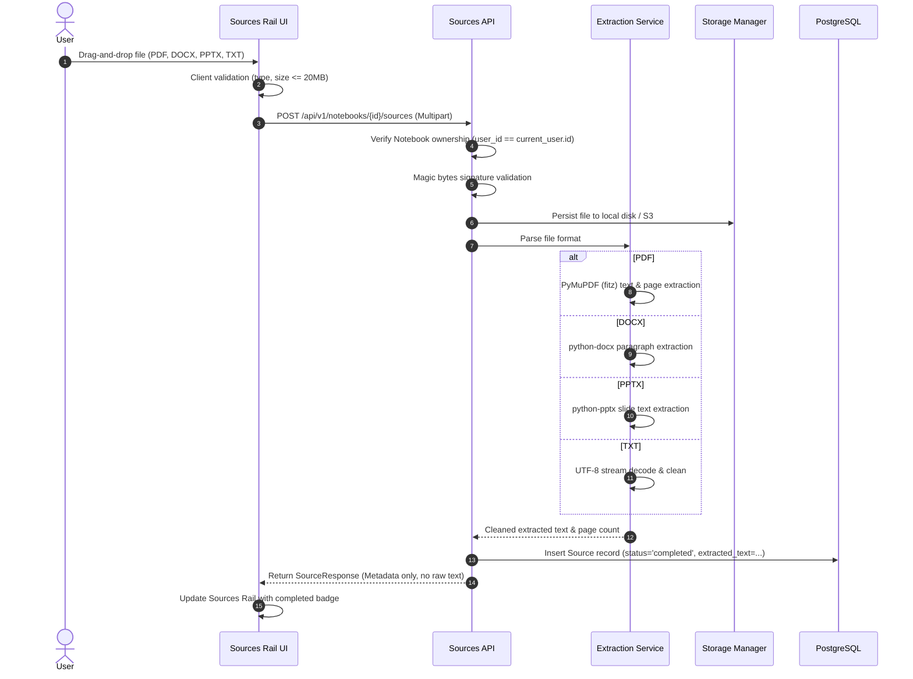
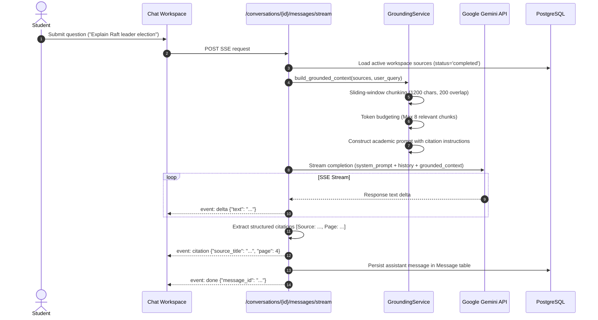
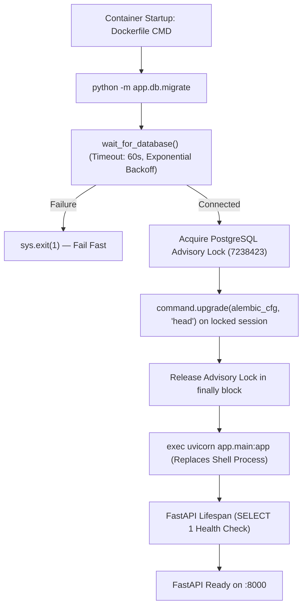

# Architecture Documentation — AI Academic Assistant

This document details the engineering architecture, data models, pipelines, and infrastructure of **AI Academic Assistant**.

---

## 1. System Topology Overview

AI Academic Assistant is structured as a decoupled full-stack application:

---

## 2. Workspace & Data Model

The application revolves around one primary concept: **Academic Chats**, internally backed by the **`Notebook`** entity.

### Data Isolation Principles:
- Every database query resolving notebooks, sources, conversations, messages, or study materials strictly filters by `user_id == current_user.id`.
- Accessing a resource owned by another user yields HTTP `404 Not Found` rather than `403 Forbidden`, preventing resource ID enumeration.
- Database foreign key constraints enforce strict referential integrity (`check_conversation_ownership_consistency`).

---

## 3. Multi-Format Source Ingestion Pipeline

---

## 4. Grounded RAG & Inline Citations Pipeline

When a user chats in a workspace with attached sources, the conversation is grounded dynamically:

---

## 5. Study Studio Generation Engine

The Study Studio provides eight interactive study tools + two modal curriculum generators:

### Tool Matrix:

| Category | Tool | Endpoint | Format | Parser / Runner |
| :--- | :--- | :--- | :---: | :--- |
| **Notes & Summaries** | Comprehensive Notes | `/api/v1/generate/notes` | SSE Markdown | Streamed Markdown viewer with copy/export |
| | Executive Summary | `/api/v1/generate/summary` | SSE Markdown | Streamed Markdown viewer |
| | Study Guide Chapters | `/api/v1/notebooks/{id}/generate/study-guide` | Saved JSON | Multi-chapter accordion with completion tracking |
| **Exams & Tests** | 5-Mark Exam Answer | `/api/v1/generate/5-mark-answer` | SSE Markdown | Structured 250–350 word model answer format |
| | 10-Mark Exam Answer | `/api/v1/generate/10-mark-answer` | SSE Markdown | Detailed essay structure with sections & conclusion |
| | Interactive MCQ Quiz | `/api/v1/generate/mcqs` | Validated JSON | Interactive runner (`parseMCQResponse`) with scoring & feedback |
| | Viva Question Prep | `/api/v1/generate/viva-questions` | Validated JSON | Oral exam simulator (`parseVivaResponse`) with answer reveal |
| | Full Exam Simulator | `/api/v1/notebooks/{id}/generate/exam-paper` | Saved JSON | Timed exam paper with section mark weighting (50/100 marks) |
| **Concept Breakdown** | Spaced Flashcards | `/api/v1/generate/flashcards` | Validated JSON | 3D Flip-card engine (`parseFlashcardResponse`) for active recall |
| | Explain Simply (ELI5) | `/api/v1/generate/explain-simply` | SSE Markdown | Intuitive plain-language analogies |

### Server-Side Document Resolution:
All tools pass `notebook_id` or `source_id` directly in `NotesGenerationRequest`. The backend resolves the text server-side from PostgreSQL, preventing client payload bloat and securing proprietary materials.

---

## 6. Database Startup Lifecycle & Advisory Locking

### Key Engineering Guarantees:
- **No Concurrency Races:** Replicas wait for advisory lock `7238423`, preventing concurrent migration collisions.
- **Lifespan Purity:** FastAPI lifespan only runs `SELECT 1` connectivity probes; Alembic is never invoked inside lifespan.
- **Fail Fast:** If migrations or connectivity fail, the container exits immediately without starting a broken web server.

---

## 7. Frontend Design System & Theme Engine

- **Academic Monolith Palette:**
  - Background: Cinematic Black (`#0B0B0C`)
  - Card & Surfaces: Charcoal Gray (`#131315`), Border (`#26262A`)
  - Primary Accent: Electric Lime (`#C6F432`)
  - Text: High-contrast pure white (`#FFFFFF`) and muted slate (`#94A3B8`)
  - Contrast Ratio: Exceeds 12:1 (WCAG AA requirement: 4.5:1)
- **Pre-paint Theme Script (`index.html`):**
  Reads `studyhub_theme` and system preference before DOM render to prevent white/dark flashes during initial page load.
- **Production SPA Rewrite (`vercel.json`):**
  Maps `/(.*)` to `/` for clean direct navigation and browser refresh across all routes.
