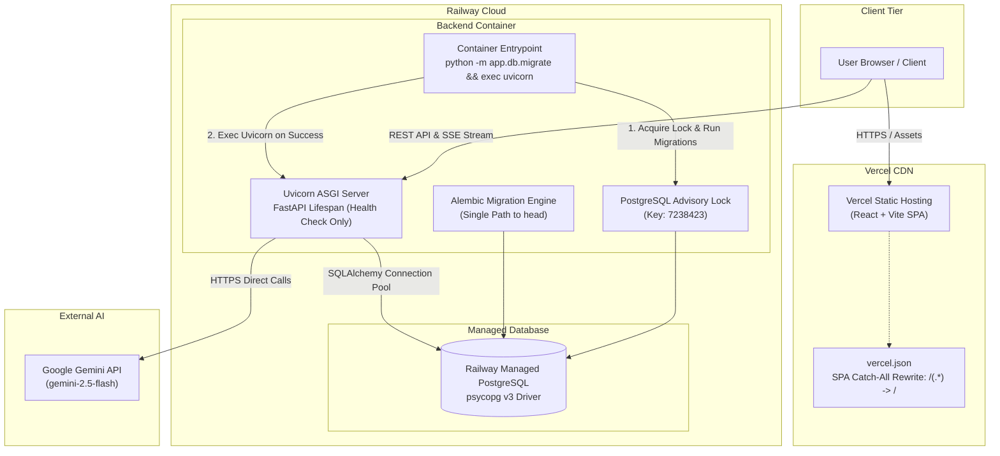

# Production Deployment Guide

This document provides complete instructions for deploying **AI Academic Assistant** across production infrastructure: **Railway** for the containerized backend and managed PostgreSQL database, and **Vercel** for the React Single Page Application (SPA).

---

## 1. System Topology & Architecture



---

## 2. Railway Backend & Database Deployment

### 2.1 Single-Path Migration Architecture

To avoid concurrency issues, deadlocks, and connection pool starvation during automated deployments, the backend adheres to a **Strict Single-Path Migration Rule**:

1. **Pre-Uvicorn Migration Runner (`app.db.migrate`):**
   - Executed before Uvicorn starts in the Docker container entrypoint:
     ```dockerfile
     CMD ["sh", "-c", "python -m app.db.migrate && exec uvicorn app.main:app --host 0.0.0.0 --port ${PORT:-8000} --workers 1"]
     ```
   - **Bounded Readiness Polling:** Probes PostgreSQL connectivity with exponential backoff (up to `DB_CONNECT_TIMEOUT_SECONDS`, default 60s) before executing Alembic.
   - **PostgreSQL Session Advisory Lock:** Acquires lock `7238423` on the connection before executing `alembic.command.upgrade(alembic_cfg, "head")`. This prevents concurrent migration collisions if multiple instances are spun up simultaneously.
   - Releases the advisory lock immediately upon migration completion or failure.
2. **Lifespan Safety:**
   - The FastAPI lifespan hook (`backend/app/main.py`) performs **readiness health checks only** (`SELECT 1`).
   - It **never** invokes Alembic or schema alterations. This eliminates duplicate migration executions, schema-locking race conditions, and startup crashes.

### 2.2 Step-by-Step Railway Deployment

1. **Create Project and Database:**
   - Create a new project in the [Railway Dashboard](https://railway.app/).
   - Add a **PostgreSQL** service to the project.
2. **Deploy Backend Service:**
   - Add a new service from your GitHub repository.
   - Set **Root Directory** to `backend`.
   - Set **Build Type** to `Dockerfile` (using `backend/Dockerfile`).
3. **Configure Railway Environment Variables:**
   Add the following variables in the Railway Service settings:

   | Variable | Value / Reference |
   | :--- | :--- |
   | `APP_ENV` | `production` |
   | `LOG_LEVEL` | `INFO` |
   | `DATABASE_URL` | `${{Postgres.DATABASE_URL}}` *(Railway variable reference)* |
   | `DB_CONNECT_TIMEOUT_SECONDS` | `60.0` |
   | `GOOGLE_API_KEY` | Your Google Gemini API Key |
   | `GEMINI_MODEL` | `gemini-2.5-flash` |
   | `JWT_SECRET_KEY` | Strong 32+ character hex string (`python -c "import secrets; print(secrets.token_hex(32))"`) |
   | `JWT_ACCESS_TOKEN_EXPIRE_MINUTES` | `1440` |
   | `CORS_ORIGINS` | `https://your-frontend-domain.vercel.app` |
   | `STORAGE_BACKEND` | `local` |
   | `UPLOAD_DIR` | `/app/uploads` |

4. **Health Check Configuration:**
   - In Railway Service Settings, configure the healthcheck path:
     - **Healthcheck Path:** `/api/v1/health`
     - **Healthcheck Timeout:** `30` seconds

---

## 3. Vercel Frontend Deployment

The frontend is a React + Vite application that compiles into optimized static assets.

### 3.1 Single Page Application (SPA) Routing & Rewrites

Because React Router handles routing in the browser, direct page reloads or deep links (e.g. `/notebooks/:id`, `/settings`, `/login`) will return HTTP 404 unless Vercel rewrites all paths back to `/index.html`.

This is guaranteed by `frontend/vercel.json`:
```json
{
  "rewrites": [
    {
      "source": "/(.*)",
      "destination": "/"
    }
  ]
}
```

### 3.2 Root Component Hierarchy & Error Resilience

To prevent white/black screen runtime crashes:
1. **ToastProvider Hierarchy:** `ToastProvider` is placed at the top level of the React tree in `App.tsx`, wrapping all routes that invoke `useToast()`.
2. **Root ErrorBoundary:** An `ErrorBoundary` wraps the router outlet, catching any unexpected runtime exceptions and displaying a clean recovery UI rather than an unhandled blank screen.
3. **Pre-Paint Theme Script:** `index.html` executes a zero-dependency script before CSS or React mounts to apply the correct theme (`dark`, `light`, or OS preference) without visual flicker.

### 3.3 Step-by-Step Vercel Deployment

1. **Import Repository in Vercel:**
   - Connect your GitHub repository in the [Vercel Dashboard](https://vercel.com/).
   - Set **Framework Preset:** `Vite`.
   - Set **Root Directory:** `frontend`.
2. **Build & Output Settings:**
   - **Build Command:** `npm run build`
   - **Output Directory:** `dist`
   - **Install Command:** `npm install`
3. **Configure Environment Variables:**
   - `VITE_API_BASE_URL`: `https://your-railway-backend.up.railway.app/api/v1`
4. **Deploy:**
   - Click **Deploy**. Vercel will build the frontend and serve it across its global edge CDN.

---

## 4. Post-Deployment Verification Checklist

Once both services are deployed, perform these verification checks:

1. **Backend Health Check:**
   ```bash
   curl -i https://your-railway-backend.up.railway.app/api/v1/health
   # Expected: HTTP 200 OK
   # Response: {"status":"healthy","database":"connected","version":"..."}
   ```

2. **Frontend Direct Navigation Check:**
   - Open your browser to `https://your-frontend-domain.vercel.app/`.
   - Refresh the page while viewing `/notebooks` or `/settings`. Ensure no 404 occurs.

3. **Authentication & Session Isolation:**
   - Register a new test user account.
   - Verify JWT issuance and redirection into the chat-centric workspace.

4. **Source Ingestion & Grounded RAG:**
   - Create a new Chat.
   - Upload a test PDF, DOCX, or PPTX file.
   - Confirm status moves from `processing` to `completed`.
   - Send a query and verify the response streams via SSE with `[Source: ...]` citations.

5. **Study Studio Generation:**
   - In the right-hand panel, click **Generate Flashcards** or **Exam Answer**.
   - Verify server-side resolution and structured JSON rendering.
